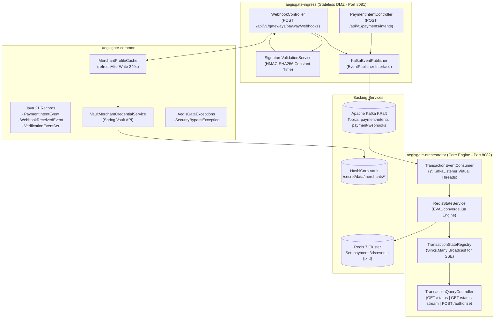
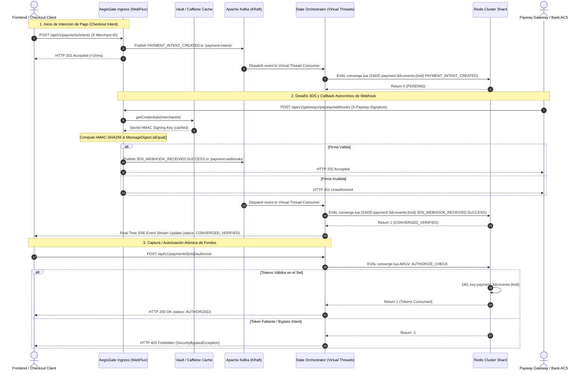
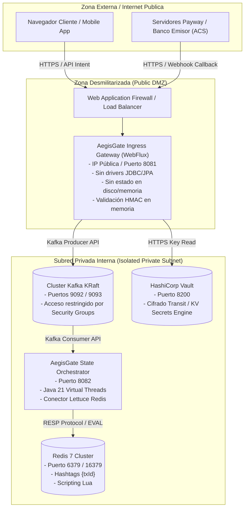

# 🏗️ AegisGate Software Architecture & Distributed Systems Design

[](https://openjdk.org/projects/jdk/21/)
[](https://spring.io/projects/spring-boot)
[](https://kafka.apache.org/)
[](https://redis.io/)

Este manual describe la arquitectura de software, patrones de diseño distribuido, justificaciones tecnológicas de ingeniería y topologías físicas de red de **AegisGate 3DS Verification Engine**.

---

## 📋 Tabla de Contenidos
1. [🧠 Filosofía Arquitectónica y Principios de Diseño](#1-filosofía-arquitectónica-y-principios-de-diseño)
2. [🔬 Justificación de Decisiones Tecnológicas](#2-justificación-de-decisiones-tecnológicas)
   - [Java 21 Virtual Threads (Project Loom)](#-java-21-virtual-threads-project-loom)
   - [Spring WebFlux (Ingress Stateless Reactivo)](#-spring-webflux-ingress-stateless-reactivo)
   - [Apache Kafka KRaft Event Bus](#-apache-kafka-kraft-event-bus)
   - [Redis Cluster Hashtags `{transactionId}` & Scripts Lua](#-redis-cluster-hashtags-transactionid--scripts-lua)
   - [Caffeine Cache (`refreshAfterWrite`) & Dynamic Vault](#-caffeine-cache-refreshafterwrite--dynamic-vault)
3. [📊 Diagramas de Arquitectura Mermaid](#3-diagramas-de-arquitectura-mermaid)
   - [Diagrama de Arquitectura Lógica Multimódulo](#-diagrama-de-arquitectura-lógica-multimódulo)
   - [Diagrama de Secuencia de Datos (Happy Path & Late Binding)](#-diagrama-de-secuencia-de-datos-happy-path--late-binding)
   - [Diagrama de Topología Física y Seguridad de Red (DMZ vs Private Subnet)](#-diagrama-de-topología-física-y-seguridad-de-red-dmz-vs-private-subnet)
4. [⚡ Atributos de Calidad y Rendimiento (NFRs)](#4-atributos-de-calidad-y-rendimiento-nfrs)

---

## 1. 🧠 Filosofía Arquitectónica y Principios de Diseño

AegisGate fue concebido para resolver la fragilidad de las integraciones 3DS monolíticas mediante tres pilares fundamentales:

1. **Event-Driven Event Sourcing en Memoria**: En lugar de consultar una base de datos relacional pesada para validar el estado de una transacción, AegisGate modela la autenticación como un conjunto (*Set*) de eventos inmutables que deben converger en memoria ($O(1)$).
2. **Desacoplamiento Estricto de Capas (DMZ vs Core Engine)**: La capa de entrada de peticiones públicas (*Ingress Gateway*) no posee acceso a bases de datos relacionales ni almacena estado persistentemente; únicamente valida firmas criptográficas y publica mensajes en la cola distribuida.
3. **Resiliencia Atómica Anti-Bypass**: Ninguna transacción puede marcarse como autorizable sin la convergencia simultánea del token de checkout intent (`PAYMENT_INTENT_CREATED`) y la confirmación del banco emisor (`3DS_WEBHOOK_RECEIVED:SUCCESS`).

```
                               ┌──────────────────────────┐
                               │  Client / Merchant Front │
                               └────────────┬─────────────┘
                                            │
                    ┌───────────────────────┴───────────────────────┐
                    │                                               │
                    v (POST /intents)                               v (POST /webhooks)
      ┌──────────────────────────┐                    ┌──────────────────────────┐
      │  AegisGate Ingress Gateway│                   │  AegisGate Ingress Gateway│
      │  (Stateless WebFlux)     │                    │  (Stateless WebFlux)     │
      └─────────────┬────────────┘                    └─────────────┬────────────┘
                    │                                               │
                    │ Publish (payment-intents)                     │ Publish (payment-webhooks)
                    └───────────────────────┬───────────────────────┘
                                            │
                                            v
                              ┌───────────────────────────┐
                              │  Apache Kafka Event Bus   │
                              └─────────────┬─────────────┘
                                            │
                                            v Consume (Virtual Threads)
                              ┌───────────────────────────┐
                              │ State Orchestrator Engine │
                              └─────────────┬─────────────┘
                                            │
                                            v EVAL converge.lua
                              ┌───────────────────────────┐
                              │    Redis Cluster Set      │
                              │ payment:3ds:events:{txId} │
                              └───────────────────────────┘
```

---

## 2. 🔬 Justificación de Decisiones Tecnológicas

### 🚀 Java 21 Virtual Threads (Project Loom)
* **Problema**: El modelo tradicional de concurrencia basado en hilos de plataforma (1:1 con hilos del SO) sufre de un costo elevado en context switching y consumo de memoria (1-2 MB por hilo). Bajo alta concurrencia de checkout (ej. CyberMonday), agotar el thread pool bloquea los endpoints.
* **Solución**: AegisGate habilita `spring.threads.virtual.enabled=true` en el microservicio `aegisgate-orchestrator`. Los hilos virtuales son gestionados por la JVM y parkean automáticamente durante I/O bloqueante (como llamadas de red a Redis o Kafka) sin bloquear el *carrier thread* subyacente del sistema operativo.
* **Impacto**: Capacidad de manejar >50,000 transacciones concurrentes con un uso de memoria footprint drásticamente reducido.

---

### ⚡ Spring WebFlux (Ingress Stateless Reactivo)
* **Problema**: El punto de entrada a la red debe recibir notificaciones de red de baja latencia sin convertirse en un cuello de botella bajo ataques de denegación de servicio (DoS) o picos de tráfico.
* **Solución**: `aegisgate-ingress` utiliza **Spring WebFlux** sobre Netty. Es completamente stateless (sin sesión HTTP) y posee cero conexiones a bases de datos relacionales (JPA/Hibernate).
* **Impacto**: Tiempo de respuesta en el borde **P99 < 10 ms**. Tras la validación criptográfica en memoria, la petición responde `HTTP 202 Accepted` de inmediato de forma no bloqueante.

---

### 📦 Apache Kafka KRaft Event Bus
* **Problema**: Las notificaciones asincrónicas de webhooks adquirentes (Payway) y las intenciones de pago del comercio pueden llegar fuera de orden o desincronizadas en el tiempo.
* **Solución**: AegisGate utiliza **Apache Kafka en modo KRaft** (sin dependencia de ZooKeeper). Los eventos `PaymentIntentEvent` y `WebhookReceivedEvent` se publican en tópicos particionados por la clave `transactionId`.
* **Impacto**: Mantiene el orden garantizado de eventos por transacción y permite desacoplar los picos de tráfico del Ingress frente a la capacidad de cómputo del Orchestrator.

---

### 🛡️ Redis Cluster Hashtags `{transactionId}` & Scripts Lua
* **Problema**: En clústeres de Redis distribuidos, ejecutar operaciones multi-clave o evaluar scripts Lua requiere que todas las claves involucradas residan en el mismo nodo/shard. De lo contrario, Redis lanza un error `CROSSSLOT Keys in request don't hash to the same slot`.
* **Solución**: El servicio [`RedisStateService.java`](file:///e:/Propios/ZyrconPay/zyrconpay-aegisgate/aegisgate-orchestrator/src/main/java/com/zyrconpay/aegisgate/orchestrator/service/RedisStateService.java) emplea la convención de **Hashtags de Redis Cluster**:
  $$\text{Key} = \text{payment:3ds:events:\{transactionId\}}$$
* **Evaluación Atómica**: El script [`converge.lua`](file:///e:/Propios/ZyrconPay/zyrconpay-aegisgate/aegisgate-orchestrator/src/main/resources/scripts/converge.lua) se ejecuta de forma atómica y mono-hilo en el shard correspondiente de Redis. Comprueba y añade los tokens dentro del conjunto (*Set*) en tiempo constante $O(1)$, impidiendo cualquier race condition de lectura/escritura concurrente.

---

### 🗝️ Caffeine Cache (`refreshAfterWrite`) & Dynamic Vault
* **Problema**: Consultar HashiCorp Vault de forma síncrona en cada webhook entrante para obtener la clave HMAC-SHA256 introduce una latencia de red inaceptable (50-100 ms) y sobrecarga la API de Vault.
* **Solución**: [`MerchantProfileCache.java`](file:///e:/Propios/ZyrconPay/zyrconpay-aegisgate/aegisgate-common/src/main/java/com/zyrconpay/aegisgate/common/cache/MerchantProfileCache.java) implementa un `LoadingCache` de Caffeine configurado con:
  * `expireAfterWrite(300, TimeUnit.SECONDS)`
  * `refreshAfterWrite(240, TimeUnit.SECONDS)`
* **Impacto**: Cuando una clave expira a los 240s, Caffeine responde inmediatamente con el valor cacheado actual al hilo de la petición HTTP y dispara la recarga desde Vault en un hilo de fondo asincrónico. La validación en el Ingress no sufre penalización de latencia.

---

## 3. 📊 Diagramas de Arquitectura Mermaid

### 📐 Diagrama de Arquitectura Lógica Multimódulo



---

### ⏱️ Diagrama de Secuencia de Datos (Happy Path & Late Binding)



---

### 🌐 Diagrama de Topología Física y Seguridad de Red (DMZ vs Private Subnet)



---

## 4. ⚡ Atributos de Calidad y Rendimiento (NFRs)

| Atributo de Calidad | Objetivo Técnico (Metric) | Estrategia de Arquitectura |
| :--- | :--- | :--- |
| **Latencia Ingress** | $P_{99} < 10\text{ ms}$ | Programación reactiva WebFlux + Caffeine Cache en memoria. |
| **Throughput Orquestación** | $> 50,000\text{ req/sec}$ | Java 21 Virtual Threads (Project Loom) sin bloqueo de SO. |
| **Disponibilidad** | $99.99\text{\% Uptime}$ | Ingress Stateless escalable horizontalmente en DMZ. |
| **Consistencia Atómica** | Zero Race Conditions | Script `converge.lua` ejecutado mono-hilo en shard de Redis. |
| **Aislamiento PCI-DSS** | Zero PAN Footprint | AegisGate no almacena datos de tarjeta (PAN/CVV). |

---

<p align="center">
  <b>AegisGate Architecture Manual</b> — Documentación oficial de arquitectura de software para ZyrconPay.
</p>
